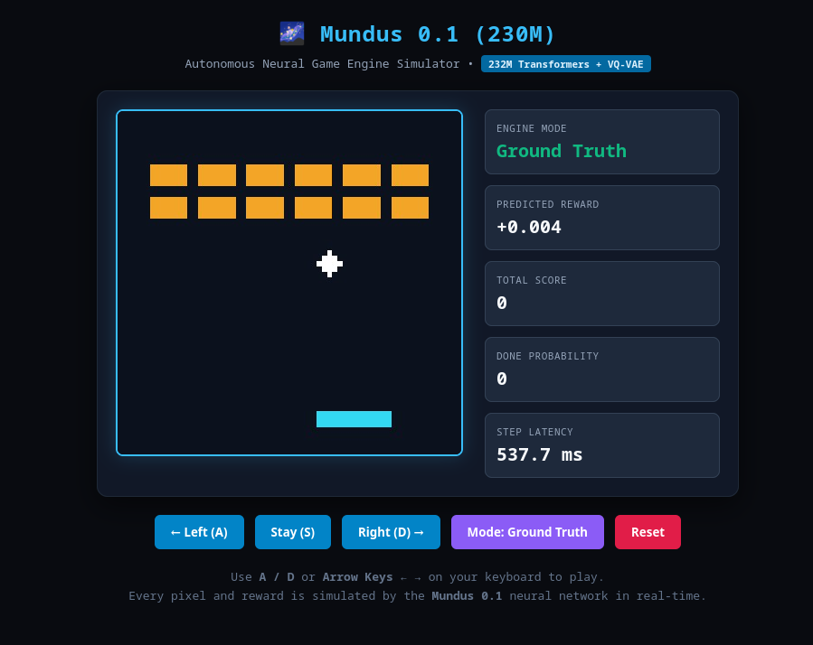

# 🌌 Mundus 0.1: Autonomous Neural Game Engine

[](https://python.org)
[](https://pytorch.org)
[](LICENSE)
[](https://huggingface.co/Tahary/mundus-0.1-world-model)

> *"Mundus"* — Latin for *World / Universe*.  
> A high-capacity, two-stage **Causal Transformer World Model** engineered for latent dynamics simulation, interactive environment rollouts, and model-based RL.

---

<p align="center">
  
</p>

---

## 🎮 Supported Game Environments

Mundus includes two self-contained game simulators written in native NumPy (zero external ROM dependencies):

1. **🔴 Doom 3D (`doom_env.py`) — First-Person Raycaster**:
   - 3D perspective projection with atmospheric depth shading.
   - 3D billboard enemy demon sprites that patrol and attack.
   - First-person double-barrel shotgun with walking bob & muzzle flash bursts.
   - Hitscan shooting mechanics with blood impacts and rewards.
   - **Controls**: `W` (Fwd), `S` (Back), `A` (Turn Left), `D` (Turn Right), `Space` (Fire Weapon).

2. **🔵 Arcade 2D (`dataset.py`) — Physics Breakout**:
   - Elastic ball collisions, paddle bounce English, brick destruction, and scoring.
   - **Controls**: `A` / Left (Move Left), `D` / Right (Move Right), `S` (Stay).

---

## ⚡ Model Specifications

| Specification | Mundus-85M (Active) | Mundus-230M (High-Capacity) |
| :--- | :--- | :--- |
| **Parameters** | **88.2 Million** | **232.1 Million** |
| **Layers** | 12 SwiGLU Transformer Blocks | 18 SwiGLU Transformer Blocks |
| **Hidden Dim ($d_{\text{model}}$)** | 768 | 1,024 |
| **Attention Heads** | 12 ($d_{\text{head}} = 64$) | 16 ($d_{\text{head}} = 64$) |
| **FeedForward Dim ($d_{\text{ff}}$)** | 2,048 (SwiGLU) | 2,752 (SwiGLU) |
| **Positional Encoding** | Rotary Position Embeddings (RoPE) | Rotary Position Embeddings (RoPE) |
| **VQ-VAE Codebook** | 2,048 Discrete Visual Codes | 2,048 Discrete Visual Codes |
| **Hardware Footprint** | 1.68 GB VRAM (GTX 1050 Ready) | 3.52 GB RAM (Multi-Core CPU / High VRAM) |

---

## 🚀 Quickstart

### 1. Installation

```bash
cd mundus-0.1-85-230M
pip install -r requirements.txt
```

### 2. Play with the Live Web Player (Browser)

Launch the browser engine:

```bash
python3 web_player.py --port 8080
```

Open **`http://localhost:8080`** in your browser.
* Switch between **Doom 3D** and **Arcade 2D** using the dropdown at the top (or pass `--env doom` / `--env arcade`).
* **Doom 3D Controls**: **`W` / `S`** (Move Fwd/Back), **`A` / `D`** (Turn Left/Right), **`Space`** (Fire Shotgun), **`R`** (Reset).
* **Arcade 2D Controls**: **`A` / `D`** or **`Left` / `Right`** (Move Paddle), **`S`** (Stay), **`R`** (Reset).
* Click the purple **Mode: Neural / Ground Truth** button anytime to toggle between the **100% Neural Hallucination** and the **Real Physics Simulator**.

### 3. Play with the Native Desktop Player (2D Arcade / CPU)

Launch the Pygame desktop player (runs the **2D Arcade** environment on **CPU**):

```bash
python3 desktop_player.py
```

* Optionally load trained weights with `--checkpoint <path>` and `--tokenizer <path>` (defaults to `checkpoints/tokenizer.pt`, and supports `--model 85m|130m|230m` when a checkpoint omits config metadata).
* **Arcade 2D Controls**: **`A` / `Left`** (Move Left), **`D` / `Right`** (Move Right), **`S` / `Down`** (Stay), **`R`** (Reset), **`ESC` / `Q`** (Quit).

### 4. Training from Scratch

```bash
# Train on Doom 3D (3D perspective raycasting)
python3 train.py --model 85m --env doom --device cuda --episodes 300 --steps 45000 --batch_size 2

# Or train on Arcade 2D (also supports --model 130m or 230m)
python3 train.py --model 85m --env arcade --device cuda --episodes 300 --steps 45000 --batch_size 2

# Standalone VQ-VAE tokenizer pre-training
python3 train_tokenizer.py --env doom
```

---

## 📦 Project Structure

```
mundus-0.1-85-230M/
├── .github/workflows/
│   └── ci.yml             # Ruff lint and CPU pytest CI workflow
├── assets/
│   ├── dashboard.png      # Web player interface screenshot
│   └── doom_preview.png   # 3D Doom environment preview
├── tests/                 # Unit tests for presets, envs, tokenizer, dataset, and web player
├── doom_env.py            # Self-contained 3D First-Person Raycaster (Doom-style)
├── dataset.py             # 2D Arcade physics game environment & trajectory dataset
├── config.py              # Architecture presets (85M, 130M, 230M)
├── tokenizer.py           # VQ-VAE visual compression model
├── world_model.py         # Causal Transformer with RoPE, SwiGLU & KV-cache
├── train.py               # Dynamics training loop supporting both Doom and Arcade
├── train_tokenizer.py     # Standalone visual codebook trainer
├── imagine.py             # Autoregressive rollout GIF generator
├── web_player.py          # Browser game engine streaming to HTML5 canvas
├── desktop_player.py      # Native desktop Pygame interface (2D Arcade / CPU)
├── upload_to_hf.py        # Hugging Face Hub checkpoint uploader
├── verify.py              # Automated 5-stage 230M verification script
├── pyproject.toml         # Project metadata, Ruff, and pytest configuration
├── requirements.txt       # Python package dependencies
├── LICENSE                # MIT License
└── README.md
```

---

## 📜 License

MIT License. Free for research, personal, and commercial experimentation.
